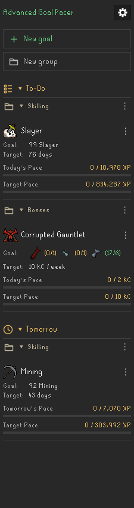

# Advanced Goal Pacer

Set XP, level, count, and boss-unique goals, then see what you need to do today to stay on pace.

## Features

- Track XP gains, skill levels, and activities listed on the official HiScores.
- Choose calendar dates and daily, weekly, monthly, or custom deadline goals.
- Repeat indefinitely, until an end date, until a lifetime boss count, or until selected unique-item totals are met.
- See Today's Pace and Target Pace, with XP/count bars and a daily progress chart.
- Defer an assignment to tomorrow and preview the revised pace. Tracking continues today; deferral clears the next day.
- Organize goals into named groups, reorder cards, and collapse sections.
- Celebrate daily assignments and overall achievements with optional completion cards and fireworks.
- Export and restore character-specific backups. Retain history indefinitely, or permanently delete a goal and its history.

## Getting started

After the plugin is available in the RuneLite Plugin Hub, search for **Advanced Goal Pacer** and install it. Open the calendar-and-progress-bar icon in RuneLite's sidebar, log in to a standard RuneScape profile, and select **New goal**.

1. Choose **Experience** or **Count**, then select the skill or activity.
2. Set the target, calendar schedule, and repeat condition. For a skill-level goal, an empty name defaults to the skill, such as **Slayer**; the Goal row shows **99 Slayer**.
3. For **Until unique**, select the items and the absolute collection-log totals you want. Every selected target must be met. Already-owned items count toward these totals.
4. Save the goal and follow the Today agenda.

**To-Do** contains work due today. **On Pace** contains assignments whose daily or period pace has been met. **Tomorrow** contains deferred work. **Completed Goals** contains overall achievements; older completed records load on request. Future and ended schedules remain accessible under **Other Goals**.

Use a card's **⋮** menu to edit, reorder, or defer it. Delete lives inside the editor. Finished goals can be reviewed and deleted; create a new goal to track more work.

Click a card for its plan, progress bars, unique quantities, daily chart, and recorded period results. The legend identifies green **Completed** bars, gold **Saved Pace**, and dashed **Forecasted pace**. Past assignments stay fixed; future pace recalculates from progress and days left. After tracking begins, missed days record zero credited progress and increasing saved pace as fewer days remain in that period. Weekly and monthly quotas reset with each period. Earlier unrecorded dates stay blank. Recovered work belongs to the day it is recognized.

See the [goal details and daily chart example](docs/images/goal-details.png). Screenshots use synthetic goals.

## How tracking works

**Experience:** XP updates in RuneLite count immediately. Login compares skill totals with saved checkpoints to recover gains made elsewhere, including on mobile.

**Counts:** Supported game completion messages update live progress. Bosses, clue tiers, and rifts need an observed in-game count to establish a baseline for later HiScores recovery. The first recognized live completion counts once. Other activities use changes in observed HiScores totals. HiScores may lag or omit unranked totals; unknown values never become zero. Score-based activities track improvements above the highest observed score. League Points requires a seasonal profile and is unavailable in this standard-profile release.

**Uniques:** Open your own relevant Collection Log page once to establish quantities. Supported native loot and reward events then update known totals automatically. Shared collection-log items share their totals. Ambiguous pets, hidden ground rewards, or interrupted reward reads require another page visit; the plugin marks uncertain quantities for verification. HiScores does not contain unique-item quantities. Opening a Collection Log page can also recover items earned on another device. Target limits are conservative plugin limits, rather than a statement about the game's native counter caps.

Recovered XP/count activity is labeled **Recovered at login** internally. Initial baselines and already-complete targets do not generate retroactive celebrations. The plugin never opens collection-log pages or performs game actions for you.

## Settings and completion cards

The upper-right gear contains **Refresh**, **Export backup**, **Restore backup**, **View clock**, **Enable groups**, and American/European **Date format**. Hidden groups retain their names, assignments, and order. Dates use the computer's local clock; existing goal calendars retain their recorded time zone. Refresh also checks HiScores, subject to a 30-second cooldown and bounded retries. Hover the source-check timestamps for collection-log refresh guidance.

RuneLite's plugin settings separately control Today completion cards, overall completion cards, and overall fireworks. Daily cards have no fireworks. Overall XP, level, unique, and lifetime-KC achievements can show fireworks. Cards wait for native notifications and level-up/quest interfaces, hide if interrupted, and resume after the native notification clears. Custom cards defer while Collection Log Popup Enhanced is enabled. There is no sound.

## Your data

Goals and history are stored per character under RuneLite's `plugin-data/mygoals/<opaque-profile-key>/standard/` directory. No account credentials are stored by this plugin. Its only network lookup is the logged-in character's official HiScores through RuneLite's HiScores client. There is no plugin-owned server, analytics, or cloud synchronization.

XP/count progress normally saves about once per minute. Edits, qualifying acquisitions, and completion changes batch within 500 ms. Logout, profile changes, disable, and normal shutdown flush current progress. History uses daily aggregates and goal-period records; it does not save a timestamped journal of every XP drop. Older data remains on disk and loads only when requested.

**Export backup** creates a ZIP of this character's goals, progress, groups, collection quantities, and complete history, including pending changes. Existing exported files are not overwritten. **Restore backup** validates identity, format, checksums, and history before confirmation. Restore replaces current data and first keeps an automatic copy under `standard/backups/`. It can transfer the same character's data between computers. Different-character backups are rejected.

**Delete goal** permanently purges that goal's definition, period/day history, completion records, and activity attribution from plugin-managed storage and recovery copies. Other goals and shared account totals remain. Previously exported ZIP files are unchanged; explicitly restoring an older export can bring its goals back.

## Compatibility and reporting problems

This release supports standard RuneScape profiles. Temporary/resetting profiles are disabled. The catalogue includes the current 71 HiScores boss/raid entries and 431 eligible item IDs. It is a versioned local catalogue; a new boss, raid mode, or collection-log change may require a plugin update. Retired or changed targets pause safely while preserving saved progress.

When reporting a problem, include the activity, goal type, expected result, and displayed result. For missed uniques, mention the reward source and whether reopening that boss's Collection Log corrects the quantity.

## Development

Use Java 11. See [development and validation](docs/DEVELOPMENT.md), [catalogue and storage maintenance](docs/MAINTENANCE.md), and [manual Plugin Hub submission](docs/SUBMITTING.md).

Licensed under the [BSD 2-Clause License](LICENSE).
